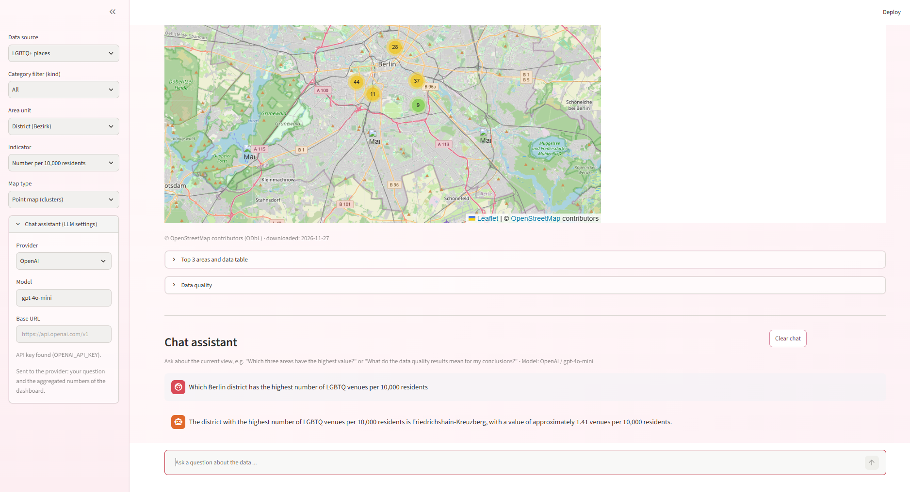
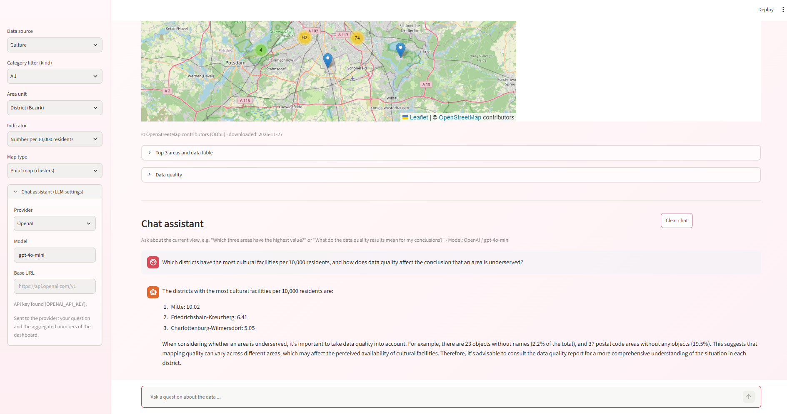

# Documentation Berlin-Bot-Extension
**Contributors**: Joana Wardenga, Michael Schön, Philipp Meyer, Yesha Raval

**Students-Project**: Data Science M.Sc., Advanced Software Engineering

Since the task want a 2 page PDF documentation we can create it here from this markdown using pandoc.
It is documented within the readme how to build a PDF from markdown.

*Task*:  Write a documentation of about 2 pages (PDF): use case, what you changed and why, the answer to your question with screenshots, limits of the OSM data, and a check of two chatbot answers against your data table.

# Use Case: Queer Berlin in one Map

You are a member of the LGBTQ+ community. You are visiting Berlin for a
weekend, staying for a limited time (e.g. an exchange semester), or living
here permanently. You want to plan a fun day and find out which places
actively welcome LGBTQ+ people.

Online, you mostly find "Top 5" lists that focus on the best-known LGBTQ+
spots. These lists have three shortcomings:

- They mainly cover bars and clubs, and miss other things you enjoy, such as
  museums, theatres and exhibitions.
- They leave out community centres and other places where you can meet
  LGBTQ+ people in a safe environment.
- The information is scattered across many sources, so combining it into a
  single day takes time.

Our Berlin-Bot extension solves this. It shows all of these places on one
map and lets you combine your interests into a complete plan for your day.

# What we changed and why
1. **Added LGBTQ+ places as a data source.** We query OpenStreetMap for LGBTQ+-related tags and keep the tag details and a place category, so users can find places beyond the bars and clubs usually featured in short lists.
2. **Added a Culture data source.** It combines theatres, arts centres, cinemas, museums and galleries, making it easier to include cultural activities when planning a day.
3. **Simplified the data-source menu for this use case.** Playgrounds and charging stations remain in the project but are hidden from the menu, keeping the visible choices more focused on places relevant to the Queer Berlin map.
4. **Applied a subtle pink visual theme.** A light rose-white background, matching sidebar and soft metric cards improve visual consistency and make the Queer Berlin interface feel welcoming without distracting from the map or data.
5. **Made Point map (clusters) the default map view.** The Streamlit app now opens with clustered individual points instead of choropleth areas or a heatmap, highlighting the location of each relevant place immediately.

# Limits of the OSM Data
The amount of LGBTQ+ Tags is not overwhelmingly good.
The cultural facilities are missing the LGTBQ+ tag almost entirely - have to work with an assumption here (assumption: Every cultural place is LGBTW+ friendly)

For “Number per 10,000 residents,” areas with fewer than 500 residents or with missing resident data are shown without a value to avoid unstable rates.

|File	|Objects	|Notes|
|-------|-------|-------|
|osm_lgbtq.csv|	132|	Downloaded 2026-11-27, so it is fresh. Separator is ;.|
|osm_culture.csv|	1,043|	357 galleries, 246 museums, 197 theatres, 140 arts centres, 89 cinemas.|
|osm_cafes.csv|	2,619|	General cafés. 13 of them are also in the LGBTQ+ file.|

# Will the Use-Case work
A full day plan works in Schöneberg and Kreuzberg, but only thinly elsewhere. 

|Your claim|	Verdict|	Evidence|
|--------|---------|----------|
|Everything on one map|	 Works|	Files have coordinates and join to PLZ and Bezirk.|
|More than bars and clubs|	 Mostly|	54 entries are bars, pubs or clubs and 12 are erotic/sauna type. The other 66 include 13 cafés, 11 community centres, 6 restaurants and bookshops.|
|"Actively welcoming"|	 Works|	The lgbtq tag has primary (89), welcome (37) and only (4). welcome places are 72% non-nightlife, so they suit daytime plans.|
|Museums, theatres, exhibitions|	Weak|	The LGBTQ+ file has 1 museum, 4 cinemas, 1 library, 0 theatres and 0 galleries. Only 5 objects appear in both files. We have to MAKE AN ASSUMPTION HERE that cultural facilities are IN GENERAL LGBTQ+ FRIENDLY|
|Community centres and safe spaces|	Works|	11 community centres and 3 social facilities, but see the gaps below.|
|Combine into one day|	Only in the core area|	38 places lie within 1 km of Nollendorfplatz. Three districts have none.|

# Checking two Chatbot Answers against our real data
**Q1**: “Which Berlin district has the highest number of LGBTQ venues per 10,000 residents, and where are the largest gaps between cultural opportunity and LGBTQ infrastructure?”

**Answer**: The district with the highest number of LGBTQ venues per 10,000 residents is Friedrichshain-Kreuzberg, with a value of approximately 1.41 venues per 10,000 residents.

**Human Assessment**: This Number is correct and also the Top 1 district was correctly identified.

{ width=80% }

**Q2**: “Which districts have the most cultural facilities per 10,000 residents, and how does data quality affect the conclusion that an area is underserved?”

**Answer**: 
- Mitte: 10.02 
- Friedrichshain-Kreuzberg: 6.41
- Charlottenburg-Wilmersdorf: 5.05
When considering whether an area is underserved, it's important to take data quality into account. For example, there are 23 objects without names (2.2% of the total), and 37 postal code areas without any objects (19.5%). This suggests that mapping quality can vary across different areas, which may affect the perceived availability of cultural facilities. Therefore, it's advisable to consult the data quality report for a more comprehensive understanding of the situation in each district.

**Human Assessment**: The numbers are correct and in fact the highest 3 (Validated against Chloropleth map type). The assessment of the data quality issues states correct numbers from the data qualities dropdown menu and a smart sentence.

{ width=80% }